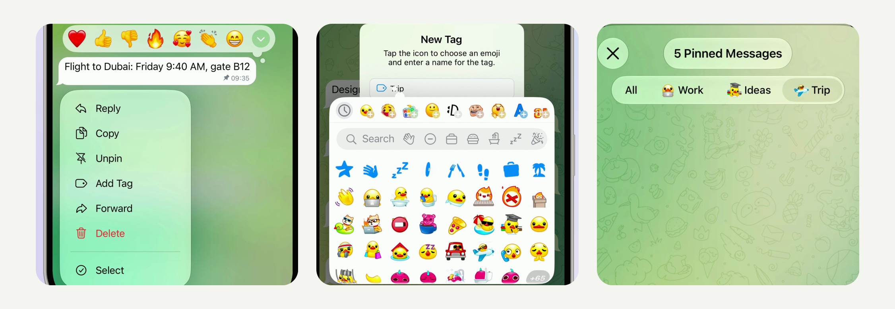

# Pinned Message Tags - sort the pinned messages of a chat (iOS)

Hold a pinned message ▸ **Add Tag** and give it a tag - a custom emoji with a name, like Trip, Work or Ideas.
The list of pinned messages then gets a row of tags above the messages, and a tap on a tag shows only the messages
with it.

[](Media/pinned-message-tags.mp4)

▶︎ [Media/pinned-message-tags.mp4](Media/pinned-message-tags.mp4) - the feature in the iOS Simulator (2160×2160, 60 fps, 25 s, loops).

Pure UIKit and Telegram's own components, no new dependencies, no server changes.
22 files, +971 −34: one new module, `PinnedMessageTags`, its stored type, and hooks in 16 existing files.
Builds with the project's own `Make.py build` (`debug_sim_arm64`).

## How it works

- **Tagging.** In a private chat, the menu of a pinned message has **Add Tag** right under **Unpin** (**Change Tag**
  once it has one). It opens a submenu: your tags with a check next to the current one, **New Tag**, and **Remove Tag**
  for a tagged message. A tag is a custom emoji with a name of up to 16 characters; a message has one tag, and the tags
  are shared by all chats of the account.
- **New Tag.** Telegram's own alert for Saved Messages tags, with one change: the emoji in the field is a button. Until
  an emoji is picked it shows a tag icon in the accent color. A tap puts the keyboard away, and once the alert has
  settled the emoji-status picker opens from that spot with every custom emoji; the picked one flies into the field.
  **Done** becomes available once there is an emoji.
- **Filtering.** The list of pinned messages (the list button on the pinned bar) shows **All** and the tags in a glass
  row above the messages. The row is only as wide as its tags and stays centered. A tap on a tag hides the messages
  without it: they fade out of the list, without the deletion dust; **All** brings them back. The row shows only the
  tags that are on pinned messages right now and disappears with the last one; if the picked tag goes away, the list
  goes back to **All**.
- **Editing.** Hold a tag in the row: **Edit Name** (the same alert, which keeps the emoji even offline), **Change
  Emoji** (the picker opens from the tag) and **Delete Tag**, which removes it from every message.
- **Unpinning under a filter.** A message unpinned from the filtered list counts as unpinned right away, while its
  undo toast is still up. If it was the last one with the tag, the list goes back to **All** instead of closing.
- **Storage.** Tags live on the device, per account, stored like Telegram's other app settings
  (`ApplicationSpecificPreferencesKeys.pinnedMessageTags`). Nothing is sent anywhere, and the other side of the chat
  does not see them.

## Repository

| Path | What |
|---|---|
| `submodules/` | The changed and new files, at their paths in Telegram-iOS. Copy over the repository. |
| `Telegram/` | The English strings (`Localizable.strings`). |
| `pinned-message-tags.patch` | The same change as one patch. |
| `Media/pinned-message-tags.mp4` | Demo. |
| `Media/preview.jpg` | Stills from the demo. |

Where the code lives:

| File | What |
|---|---|
| `TelegramUI/Components/PinnedMessageTags/` | **New module.** |
| `…/PinnedMessageTagsManager.swift` | One per account: the stored tags, the tag picked in each chat's pinned list, the tags its row shows. |
| `…/PinnedMessageTagMenu.swift` | **Add Tag** and its submenu, the New Tag / Edit Tag alert, the emoji picker. |
| `…/PinnedMessageTagsPanelNode.swift` | The row of tags above the pinned messages and the menu of a held tag. |
| `TelegramUIPreferences/…/PinnedMessageTags.swift`, `PostboxKeys.swift` | **New stored type**: tags and the tag of each message. |
| `TelegramUI/…/ChatControllerPinnedMessageTags.swift` | **New.** In the pinned list: which tags are in use, which messages to hide. |
| `ChatInterfaceStateContextMenus.swift` | **Add Tag** under **Unpin** in the message menu. |
| `ChatInterfaceTitlePanelNodes.swift` | Shows the row in the pinned list while any pinned message has a tag. |
| `ChatController.swift` | Starts the tags with the chat screen. |
| `ChatControllerOpenMessageContextMenu.swift`, `…OpenPollContextMenu.swift`, `…OpenTodoContextMenu.swift` | Pass the account to the message menus, so custom emoji draw in their items. |
| `ChatControllerLoadDisplayNode.swift` | The pinned list, which closes once it is empty, first goes back to **All** when the tag filter emptied it. |
| `SavedTagNameAlertController.swift` | `savedTagEditorAlertController`: the tag alert with a tappable emoji, for a new tag (no emoji yet) or an edited one. |
| `LegacyChatHeaderPanelComponent.swift` | `contentVersion` (a panel can ask to be laid out again without a chat state change) and `fittedContentWidth`. |
| `HeaderPanelContainerComponent.swift`, `ChatControllerNode.swift` | A single narrow panel gets a background as wide as its content, centered. |
| `ChatHistoryListNode.swift` | `ignoreMessageIdsAnimateAsDeletion`: filtered messages leave without the deletion effect; the messages waiting for their unpin undo, as a signal. |
| `Localizable.strings`, two `BUILD` files | Strings and the new dependencies. |

## Apply

Applies cleanly to [TelegramMessenger/Telegram-iOS](https://github.com/TelegramMessenger/Telegram-iOS) `master`
(`279f89e4d4f63f17227bf877dc3d8990f22ecd58`):

```sh
git apply pinned-message-tags.patch
```

or copy `submodules/` and `Telegram/` over the repository. Then build as described in the Telegram-iOS README.

## Notes and limits

- The conversation in the video is staged for the demo: a fictional chat stored on the simulator, nothing was sent
  and nothing was pinned on a server. It is not a real conversation with Pavel Durov. The avatar is a drawing. The
  letter-by-letter typing of the tag name and the reset at the end of the loop are part of the recording setup only,
  not of the patch; everything else is the app running this code.
- Tags are kept on the device and are not synced between devices: Telegram has no server field for them. A production
  version would store them in the cloud, like Saved Messages tags.
- A tag stays with its message when the message is unpinned, so pinning it again brings the tag back. The filter
  looks at the latest 1000 pinned messages of the chat.
- Private chats only. Groups and channels would work the same way, but their pins are shared by many people, and a
  personal tag there is a separate product decision.
- Tag icons are custom emoji from the emoji-status picker, as with Saved Messages tags. The picker's first item (the
  default status star) has no emoji, so picking it changes nothing.
- Only English strings are added; other languages fall back to them.
- Checked in the simulator: Add Tag / Change Tag and the submenu with the check, New Tag with the emoji picker,
  Remove Tag, the row and filtering by each tag, Edit Name, Change Emoji, Delete Tag (also of the picked tag),
  unpinning the last message of the picked tag (the list stays open), the tags after a relaunch, a row of long tags
  wider than the screen (it scrolls), the dark theme; a clean build of the patch. Not checked on a device, in a
  release build or with right-to-left text.

## License

An unofficial change to [Telegram-iOS](https://github.com/TelegramMessenger/Telegram-iOS), not affiliated with Telegram,
published openly so that it can be used under the terms of the original project.
